<div align="center">

# mermaid-unicode

### Mermaid diagrams as Unicode box-drawing art. Pure Python.

Write Mermaid, get a diagram that works anywhere text works:<br>
terminals, pull requests, commit messages, tickets, Slack, docstrings, and the output of your coding agent.

[](#install)
[](#install)
[](docs/FIDELITY.md)
[](LICENSE)

[Quick start](#quick-start) · [Gallery](#gallery) · [Command line](#command-line) · [Python API](#python-api) · [Tips](#tips-for-great-output) · [Troubleshooting](#troubleshooting)

</div>

<p align="center">
  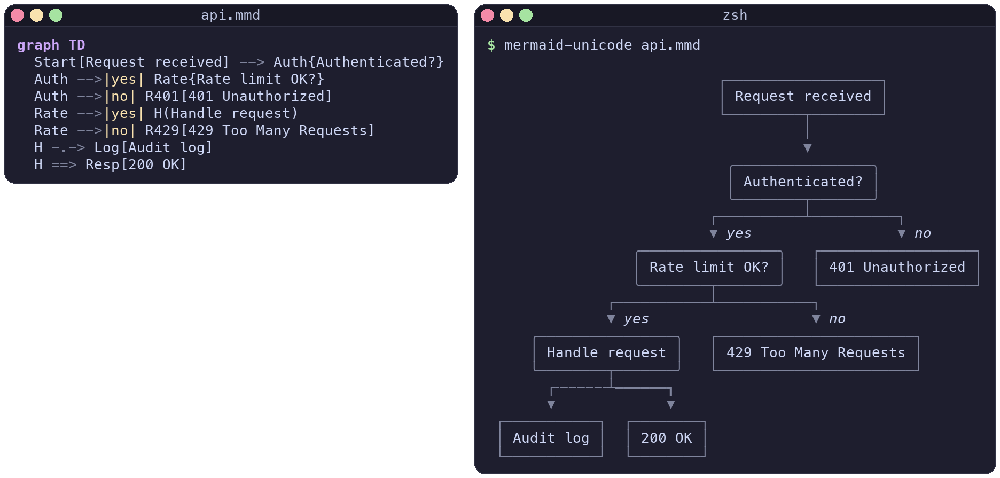
</p>

```sh
uv tool install git+https://github.com/makdoudN/mermaid-unicode.git
mermaid-unicode -t 'flowchart LR; A[Write Mermaid] --> B[Get box art]'
```

```text
┌───────────────┐    ┌─────────────┐
│ Write Mermaid ├───▶│ Get box art │
└───────────────┘    └─────────────┘
```

**Five diagram types. Zero browsers, fonts or image files. Output you can paste anywhere.**

## Why you might want this

| Diagrams where images cannot go | Faithful to a proven renderer | Built for pipelines and agents |
| --- | --- | --- |
| PR and commit descriptions, tickets, chat, log output, docstrings, plain-text docs, SSH sessions. If it shows monospaced text, it shows your diagram. | A 1:1 port of the terminal Mermaid renderer in [grok-build](https://github.com/xai-org/grok-build), checked byte-for-byte against the Rust original on roughly 96,000 cases. Same layout, same glyphs, same fallbacks. | Reads stdin, respects the terminal width and `NO_COLOR`, converts whole Markdown files in place, and exposes a small Python API. Coding agents hand-draw box art that drifts at the first edit; give them this CLI instead. |

## Quick start

### Install

Python 3.10 or newer. The only runtime dependency is [Typer](https://typer.tiangolo.com/).

```sh
# with uv (recommended): puts `mermaid-unicode` on your PATH
uv tool install git+https://github.com/makdoudN/mermaid-unicode.git

# with pipx
pipx install git+https://github.com/makdoudN/mermaid-unicode.git

# from a local clone (handy while hacking on it)
git clone https://github.com/makdoudN/mermaid-unicode.git
uv tool install ./mermaid-unicode

mermaid-unicode --install-completion   # optional shell completion
```

> Behind a corporate proxy that re-signs TLS, add `--native-tls` to the `uv` commands so uv trusts the system certificate store.

### Render something

```sh
mermaid-unicode diagram.mmd                    # a file: raw Mermaid, or a ```mermaid fence
cat diagram.mmd | mermaid-unicode -w 80        # stdin, at most 80 columns wide
mermaid-unicode -t 'graph LR; A --> B --> C'   # inline source
pbpaste | mermaid-unicode -c never | pbcopy    # macOS clipboard round trip, no colors
mermaid-unicode examples                       # 16 built-in diagrams to play with
```

```text
$ mermaid-unicode examples flowchart-decision
flowchart TD
    A[Start] --> B{Is it working?}
    B -->|Yes| C[Ship it]
    B -->|No| D[Debug]
    D --> B

        ┌───────┐
        │ Start │
        └───┬───┘
            │
            ▼
   ╭────────────────╮
   │ Is it working? │◄───┐
   ╰────────┬───────╯    │
      ┌─────┴──────┐     │
      ▼ Yes        ▼ No  │
 ┌─────────┐   ┌───────┐ │
 │ Ship it │   │ Debug ├─┘
 └─────────┘   └───────┘
```

In a terminal the output is colored (dim borders, bold titles, italic edge labels) and sized to the window. When piped or written to a file it is plain text with no width limit, ready to paste.

## Gallery

Every screenshot below is a built-in example: run `mermaid-unicode examples NAME` to reproduce it, or `--source` to get the Mermaid text.

### Sequence diagrams

Participants with aliases, every arrow kind, self messages, notes, `loop` / `alt` / `opt` / `par` / `critical` / `break` blocks and `autonumber`.

<p align="center">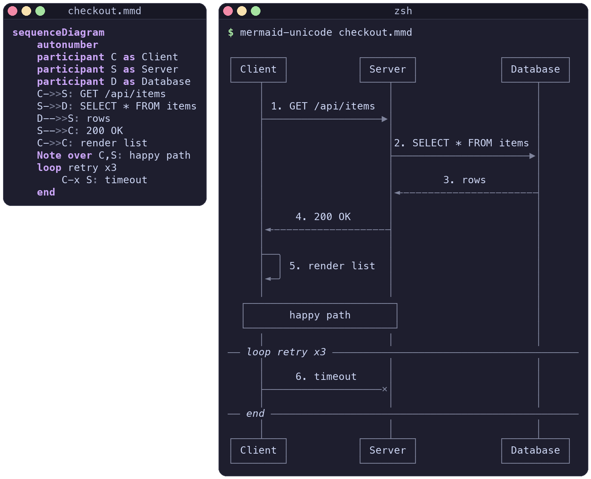</p>

<details>
<summary>Mermaid source (<code>examples sequence-full</code>)</summary>

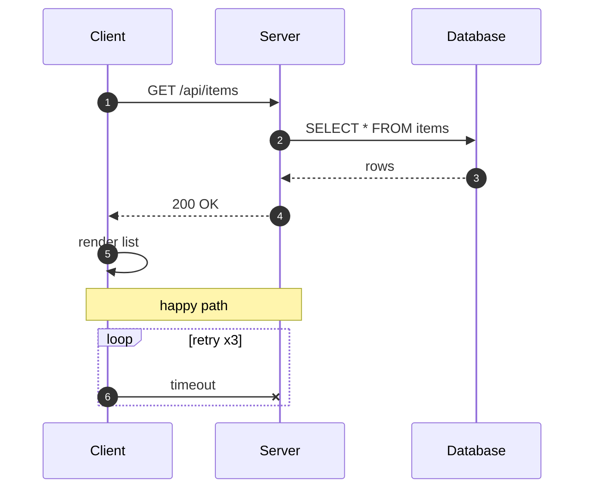

</details>

### State diagrams

`[*]` start and end markers, labelled transitions, aliases, `<<choice>>`, descriptions and `direction`.

<p align="center">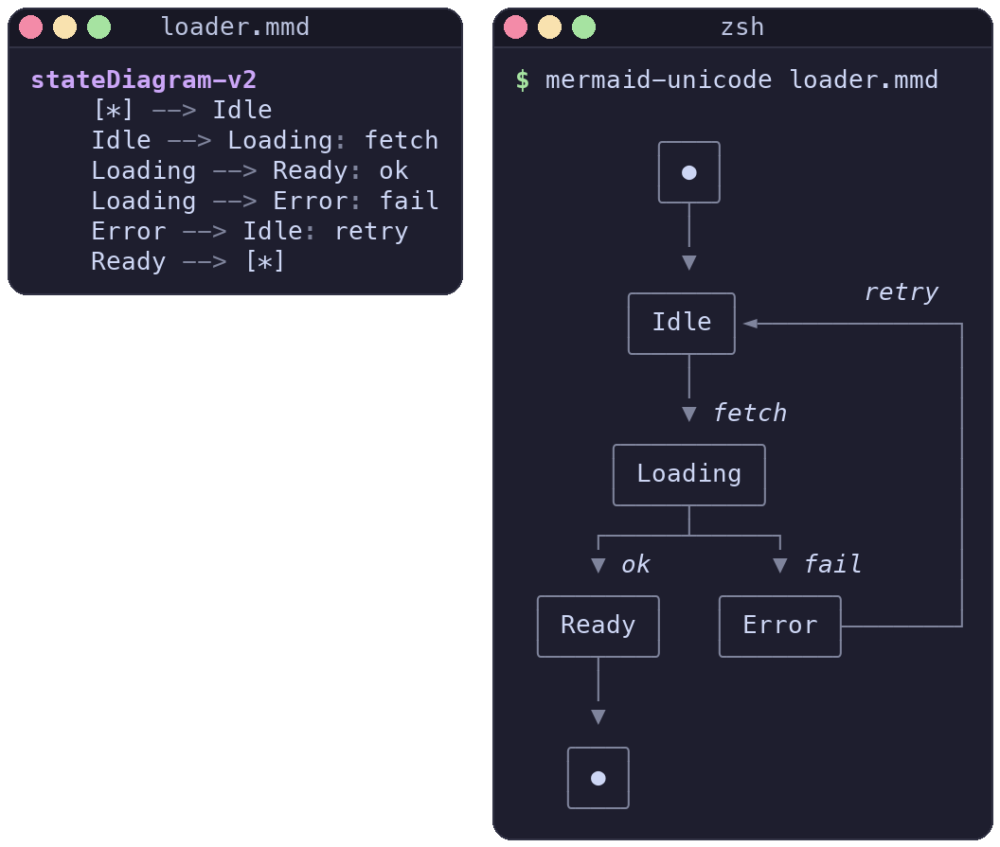</p>

<details>
<summary>Mermaid source (<code>examples state-lifecycle</code>)</summary>

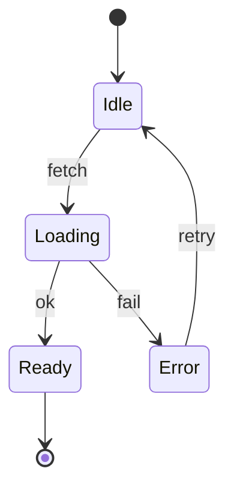

</details>

### Class diagrams

Annotation, attribute and method compartments, every relation kind, cardinalities and generics (`~T~` becomes `<T>`).

<p align="center">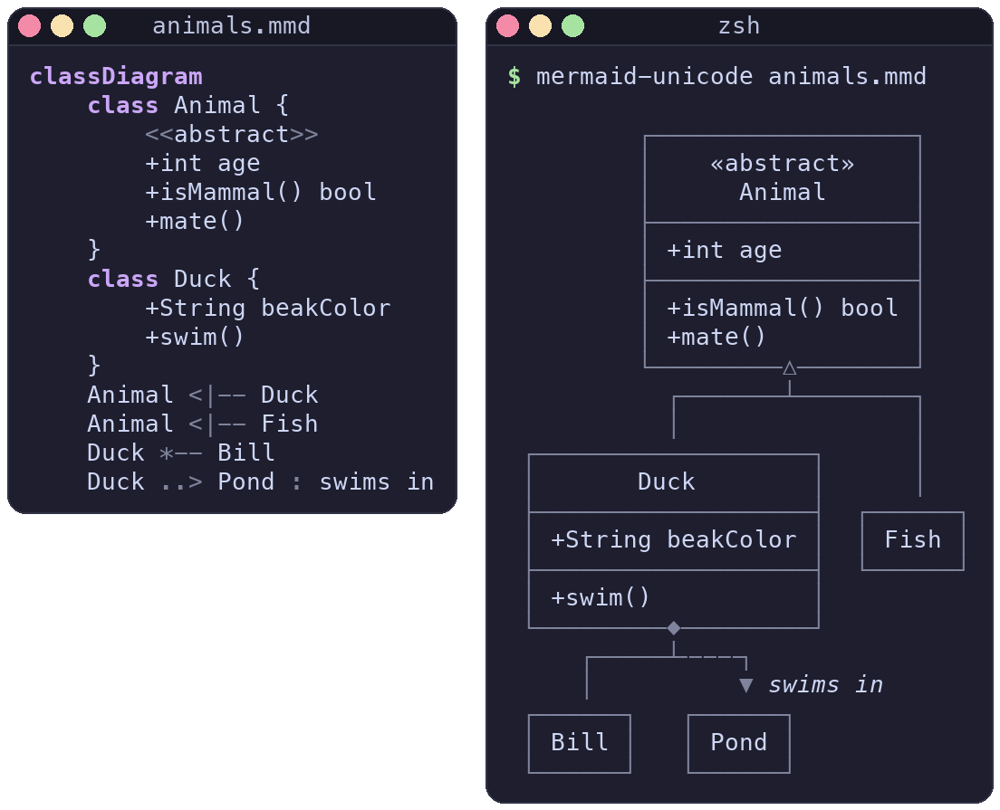</p>

<details>
<summary>Mermaid source (<code>examples class-animals</code>)</summary>

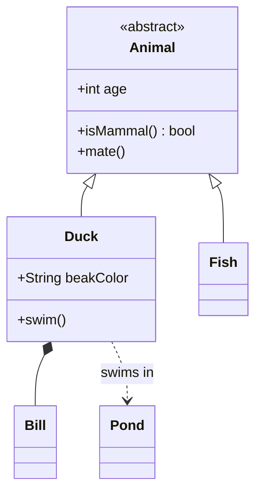

</details>

### Entity-relationship diagrams

Cardinality operators (`||--o{` and friends), identifying and non-identifying lines, attribute blocks and aliases.

<p align="center">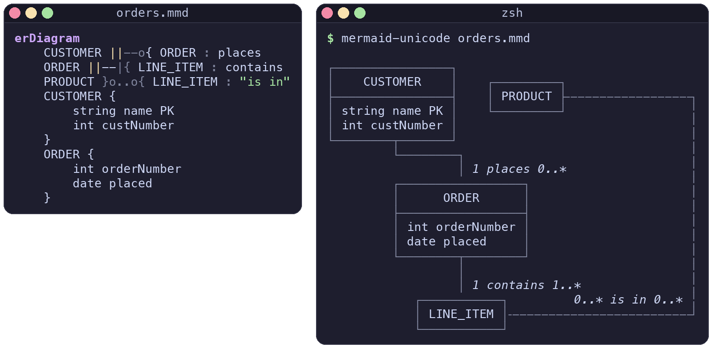</p>

<details>
<summary>Mermaid source (<code>examples er-orders</code>)</summary>

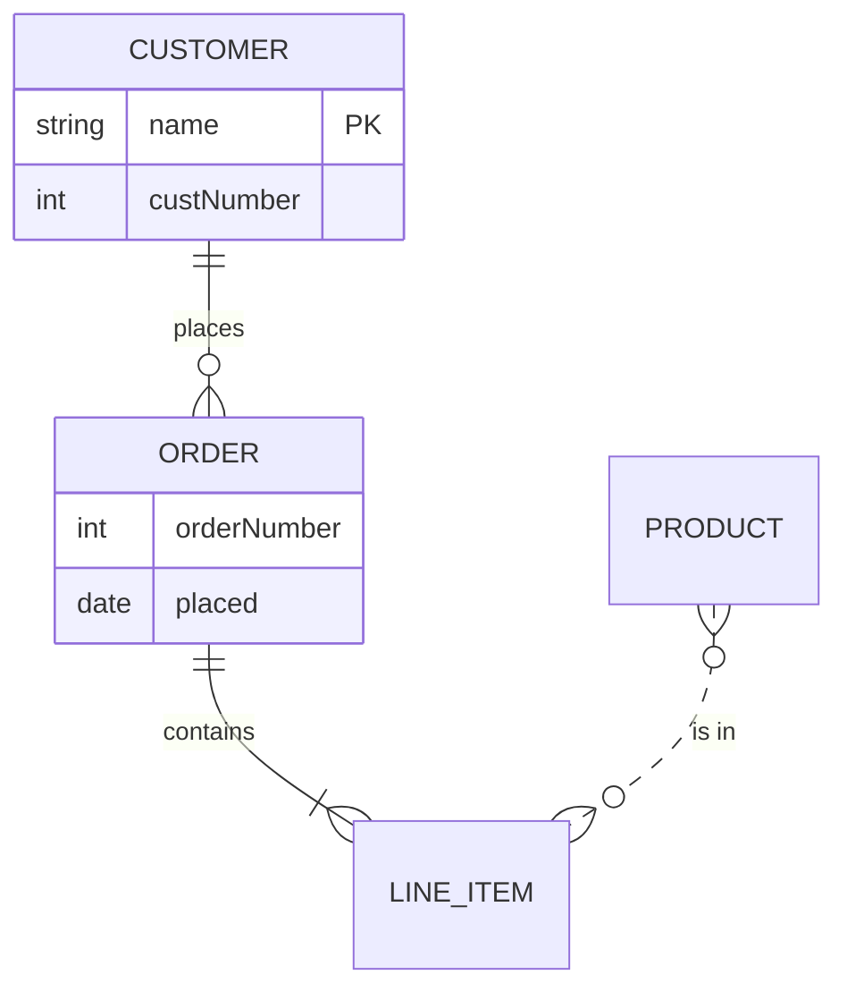

</details>

### Flowcharts with subgraphs

Nested, titled `subgraph` frames. Edges can target a subgraph as a whole.

<p align="center">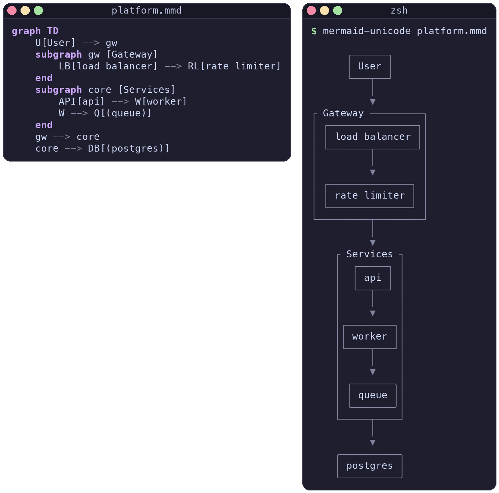</p>

<details>
<summary>Mermaid source (<code>examples flowchart-subgraphs</code>)</summary>

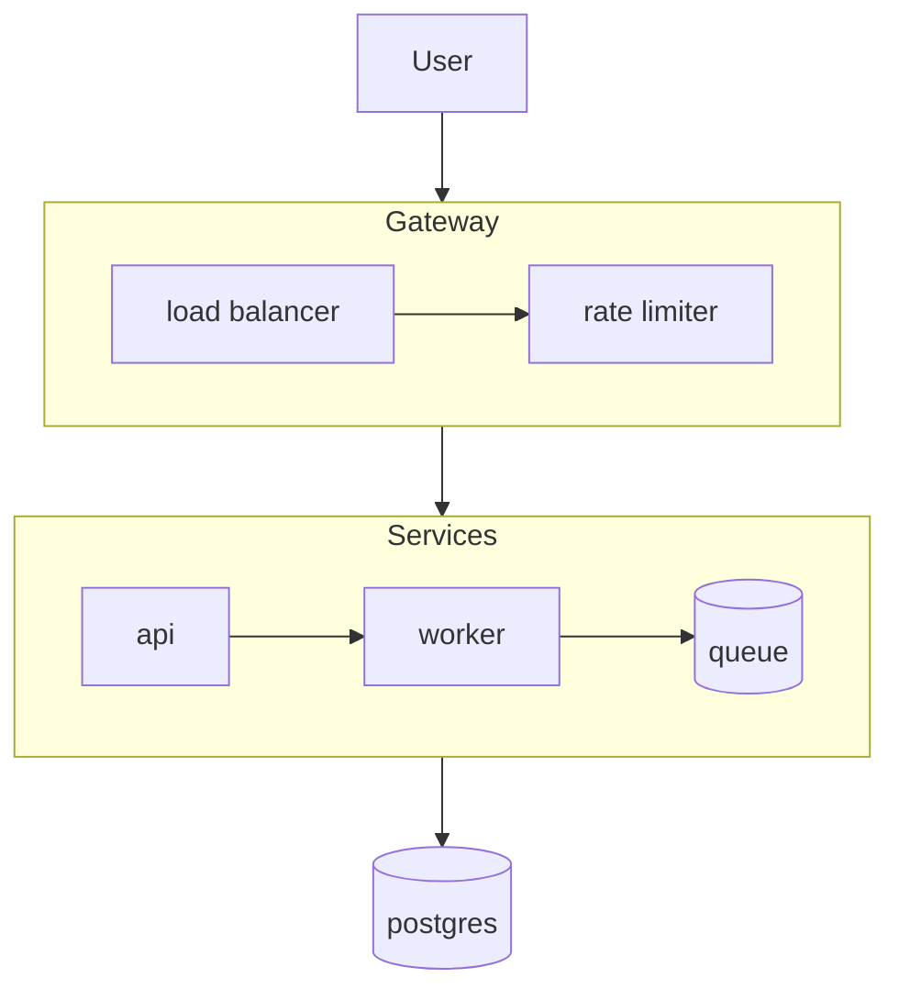

</details>

### Line breaks in labels

A `\n` inside a label, a `<br/>` tag, or a quoted label that continues on the next source line each start a new row inside the box.

<p align="center">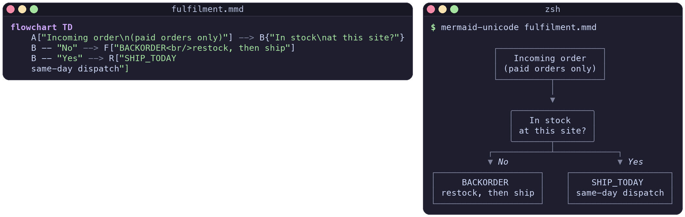</p>

<details>
<summary>Mermaid source (<code>examples flowchart-multiline</code>)</summary>

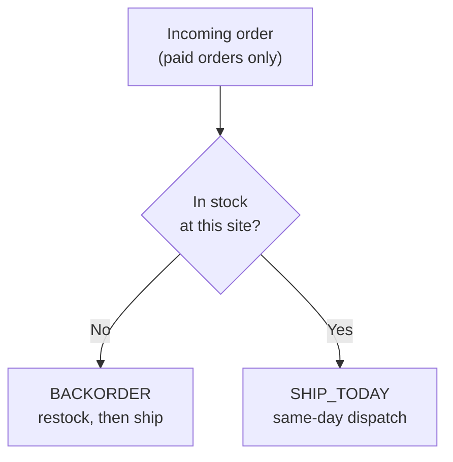

</details>

### Step charts: wide, left-aligned boxes

Labels wrap at 24 columns and are centred by default, which suits decision trees. A pipeline whose steps carry a title line and a detail line reads better the way people hand-draw it: `-W 44 --align left`.

<p align="center">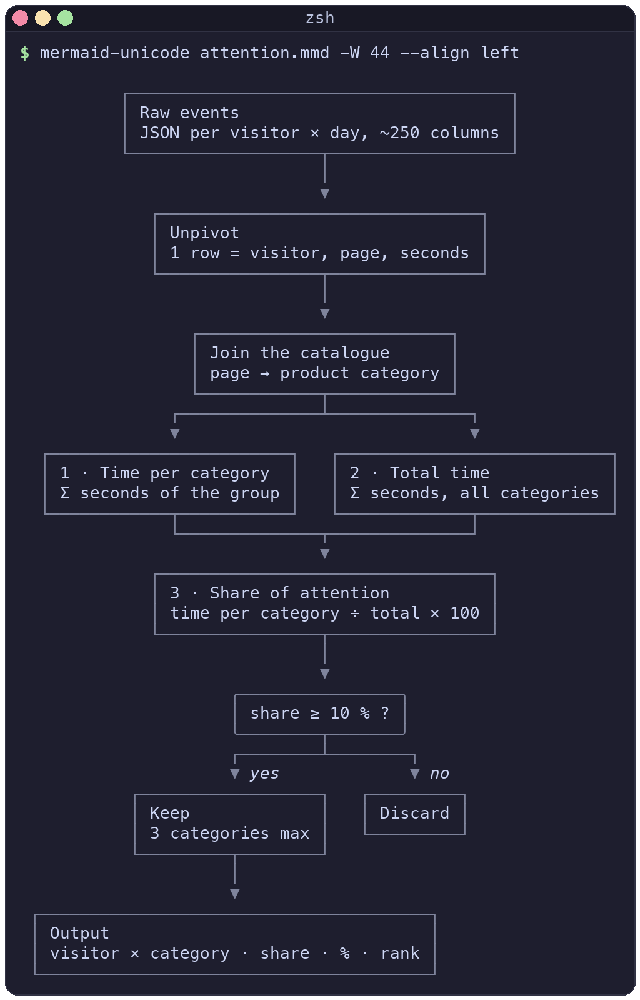</p>

<details>
<summary>Mermaid source (<code>examples flowchart-pipeline</code>)</summary>

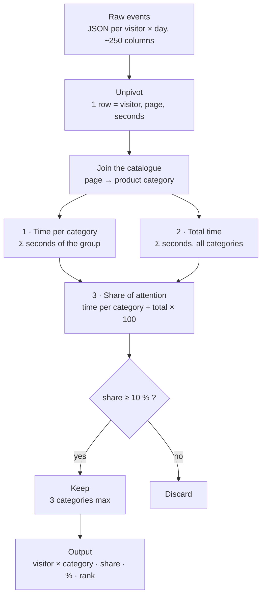

</details>

### Fits the width you have

Give it a width limit and a sequence diagram wraps its messages, notes and participant names until it fits. The same sequence as above, squeezed into 44 columns:

<p align="center">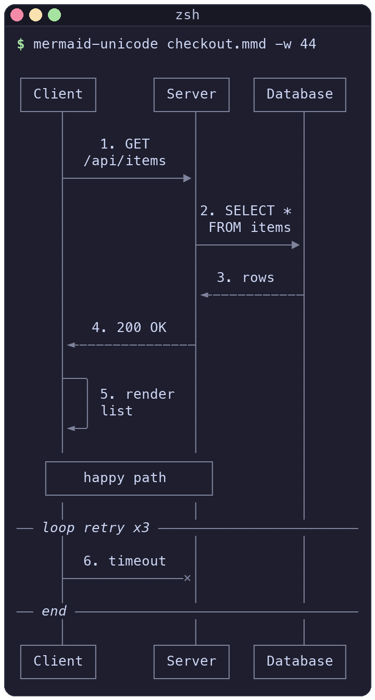</p>

A diagram that cannot fit, or a diagram type that is not supported, falls back to its source in a framed box with a hint, so nothing is ever silently dropped:

```text
$ mermaid-unicode -t 'pie title Pets
  "Dogs" : 3'
╭ mermaid: pie ──╮
│ pie title Pets │
│   "Dogs" : 3   │
╰────────────────╯
```

## Markdown documents

Turn every ```` ```mermaid ```` fence in a document into box art, wrapped in a ```` ```text ```` fence so it stays monospaced wherever the document is read. Fences indented inside lists are handled.

<p align="center">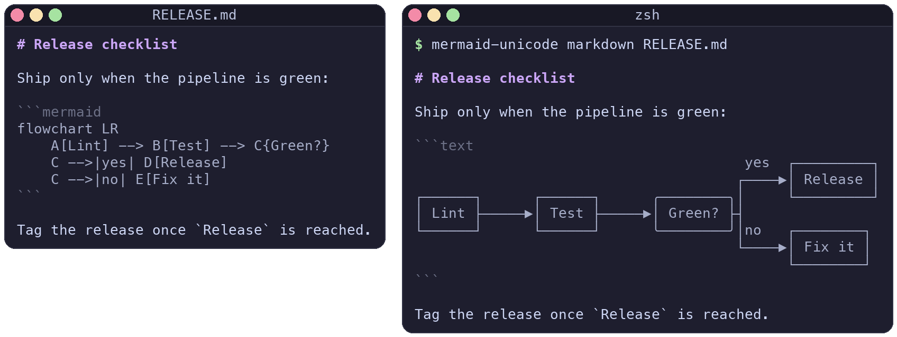</p>

```sh
mermaid-unicode markdown README.md -o README.txt.md   # write a converted copy
mermaid-unicode markdown NOTES.md --in-place -w 100   # overwrite, diagrams at most 100 columns
mermaid-unicode markdown NOTES.md --raw               # bare art, no ```text fence
```

## Command line

`mermaid-unicode --help` lists the commands; `mermaid-unicode COMMAND --help` details each one.

| Command | What it does |
| --- | --- |
| `mermaid-unicode [FILE]` / `-t SRC` / `… \| mermaid-unicode` | **render** one diagram (the default command) |
| `mermaid-unicode markdown FILE [-o OUT \| --in-place] [--raw]` | replace every ```` ```mermaid ```` fence in a document |
| `mermaid-unicode inspect FILE [-w N]` | explain how a source is parsed and whether it fits |
| `mermaid-unicode examples [NAME] [--source]` | list the built-in diagrams, or render one |

Options shared by `render`, `markdown` and `examples`:

| Option | Meaning |
| --- | --- |
| `-w, --width N` | Maximum width in columns. Default: the terminal width on a TTY, unlimited when piped. `0` means unlimited. |
| `-c, --color auto\|always\|never` | ANSI colors. `auto` colors only a TTY and honours `NO_COLOR`. |
| `-o, --output FILE` | Write to a file instead of stdout (colors off). |
| `-W, --wrap N` | Wrap node, note and participant labels at N columns (default 24). |
| `--align center\|left` | Text alignment inside boxes (default `center`). |
| `-t, --text SRC` | Inline Mermaid source instead of a file. A literal `\n` is expanded when the text has no real newline. |

`inspect` answers the question "why did it render as a framed box?":

```text
$ mermaid-unicode inspect checkout.mmd -w 44
kind          sequenceDiagram
participants  3
items         9
canvas        57 × 34 (columns × rows)
width limit   44: fits by wrapping text (41 × 37)
```

## Python API

```python
from mermaid_unicode import render_plain, RenderOptions

print(render_plain("flowchart LR\n  A --> B --> C", max_width=80))
print(render_plain(src, max_width=100, options=RenderOptions(wrap_width=48, align="left")))
```

Styled output uses the same `MermaidStyles` / `Style` / `Span` / `Line` shapes as the Rust code, so you can paint it with your own palette or feed it to a TUI:

```python
from mermaid_unicode import Color, MermaidStyles, Modifier, Style, render, render_ansi

theme = MermaidStyles(
    border=Style(fg=Color.rgb(137, 180, 250)),
    edge=Style(fg=Color.rgb(148, 226, 213)),
    edge_label=Style(fg=Color.rgb(249, 226, 175), add_modifier=Modifier.ITALIC),
    title=Style(fg=Color.rgb(250, 179, 135), add_modifier=Modifier.BOLD),
)
print(render_ansi(open("cache.mmd").read(), styles=theme))   # ANSI escapes, true color

art = render("sequenceDiagram\n  A->>B: hi", theme, max_width=None)
art.plain_lines    # list[str]
art.styled_lines   # list[Line]; Line.spans -> [Span(content, style), ...]
```

<p align="center">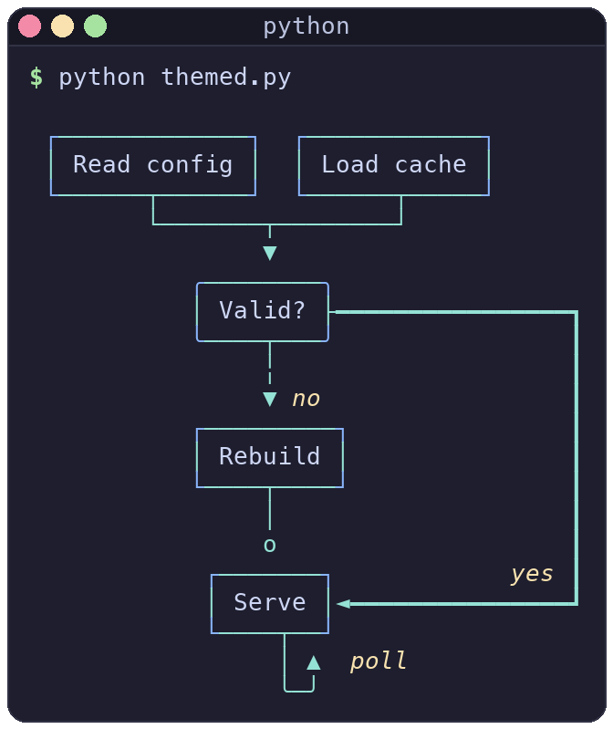</p>

`render(src, styles, max_width, options=None)` mirrors the Rust signature. It returns `None` for blank input and otherwise a `MermaidArt`. `max_width=None` means unlimited. `RenderOptions(wrap_width=24, max_lines=4, align="center")` holds the knobs behind `-W` and `--align`. `str_width` and `char_width` expose the display-width rules the layout uses.

## Use it from a coding agent

Coding agents like to hand-draw box art, and hand-drawn art drifts at the first edit. Point yours at the CLI instead. A paragraph like this in your `CLAUDE.md` or `AGENTS.md` is enough:

```text
When a diagram is needed in a terminal, PR, ticket or Markdown file, write Mermaid and render it with
`mermaid-unicode -c never -w 80 FILE` (or `-t '<source>'`). Paste the output inside a ```text fence and
keep the Mermaid source next to it. If the output is a framed "mermaid:" box, run `mermaid-unicode inspect FILE`
and fix the source. Use `-W 48 --align left` for step-by-step pipelines.
```

## Tips for great output

- **Quote labels** that contain `( ) [ ] { } | ; : " #`, or that start with a space: `A["SUM(x) · 42 %"]`. An unquoted `(` or `[` inside a label ends the node early and spawns stray nodes.
- **Break lines on purpose.** `A["Title\ndetail"]` gives each step a title line and a detail line. Wrapping cuts at the wrap width and centres, which rarely reads as well.
- **Edge labels**: `A -->|yes| B` is the safest form. In `A -- text --> B`, never put `<`, `>` or `<br/>` in the text.
- **Length limits**: a label paragraph is cut with `…` after 4 lines (raise with `RenderOptions(max_lines=…)`); edge labels after 40 columns. Shorten, or add breaks.
- **Pick a width for the destination**: `-w 80` for a README or PR description, 100 to 120 for a terminal, `0` for unlimited.
- **Shapes**: `[ ]` is a rectangle; `( )`, `([ ])`, `[( )]`, `(( ))`, `{ }`, `{{ }}` are rounded boxes; `> ]` is a rectangle. Decisions are rounded boxes, not diamonds. The parallelogram `[/ /]` is not recognised, so use `[ ]`.
- **Ignored, harmlessly**: `style`, `classDef`, `class`, `linkStyle`, `click`, `%%` comments and `direction` inside subgraphs.
- **Not supported** (shown as framed source): gantt, pie, mindmap, gitGraph, journey, timeline, quadrant, xychart, C4, requirement, block, sankey, zenuml.

## Supported syntax

| Diagram | Supported |
| --- | --- |
| `graph` / `flowchart` | `TD` `TB` `LR` `RL` `BT`; all node shapes; `&` fan-out; `-->` `---` `-.->` `==>` `<-->`; `o` and `x` endings; `\|label\|` and `-- text -->` labels; nested `subgraph` frames; self loops; back edges routed in side lanes; crossing minimisation; hard line breaks in labels |
| `sequenceDiagram` | participants and actors with aliases; all arrow kinds; self messages; `Note over/left of/right of`; `loop` `alt` `opt` `par` `critical` `break` dividers; `autonumber`; wraps text to fit a width limit |
| `stateDiagram` / `stateDiagram-v2` | `[*]`; aliases; `<<choice>>`; descriptions; `direction`; chained transitions (notes are skipped) |
| `classDiagram` | annotation, attribute and method compartments; all relation kinds; cardinalities; generics `~T~` → `<T>`; `direction` |
| `erDiagram` | cardinality operators (`\|\|--o{` …); identifying and non-identifying lines; attribute blocks; aliases |
| anything else | the source in a framed box with a hint, exactly like upstream |

## Troubleshooting

| Symptom | What to do |
| --- | --- |
| A framed `╭ mermaid: … ╮` box instead of a diagram | Run `mermaid-unicode inspect FILE`. Either the diagram type is unsupported, or one statement did not parse (usually an unquoted label with brackets, or a lone `"`). |
| A "too wide" hint | Raise `-w` or use `-w 0`; shorten labels or add `\n`; lower `-W`. |
| Boxes too narrow, text centred in a step chart | `-W 48 --align left`. |
| ANSI escape codes in a file | `-c never`, or write with `-o FILE`. |
| Nothing happens and the help is printed | Nothing was piped on stdin: pass a `FILE`, `-t`, or pipe the source. |
| Output looks misaligned in Slack or a web page | The destination is not using a monospaced font. Put the art inside a code block or a ```` ```text ```` fence. |

## How faithful is the port?

It is a line-by-line port of `mermaid.rs` from grok-build (upstream commit `a28ee2b`): same parsers, layout algorithms, glyphs and fallbacks. A differential harness renders about 96,000 `(source, width)` cases, fuzzed and hand-written, through both the Python port and a Rust reference binary, and requires identical plain lines and identical styled spans. The 145 upstream unit tests are ported one-to-one.

Two deliberate departures are on by default and documented in [docs/FIDELITY.md](docs/FIDELITY.md): hard line breaks in labels, and a small set of layout polish items (a space after arrowheads, side-lane labels that are never dropped, wider edge labels, and width-adaptive sequence diagrams). A single switch restores the exact upstream output.

## Development

```sh
git clone https://github.com/makdoudN/mermaid-unicode.git && cd mermaid-unicode
uv sync --group dev
uv run python -m pytest tests -q        # 200 tests; the differential tests need the Rust reference binary
```

See [CONTRIBUTING.md](CONTRIBUTING.md) for the layout of the repository, the differential harness against the Rust reference, and how to regenerate the Unicode tables and the screenshots.

## License

Apache-2.0, like the upstream code. See [LICENSE](LICENSE) and [NOTICE](NOTICE).

Credits: the renderer is a port of [grok-build](https://github.com/xai-org/grok-build)'s `mermaid.rs` by SpaceXAI. The display-width tables derive from the Rust [unicode-width](https://github.com/unicode-rs/unicode-width) crate.
